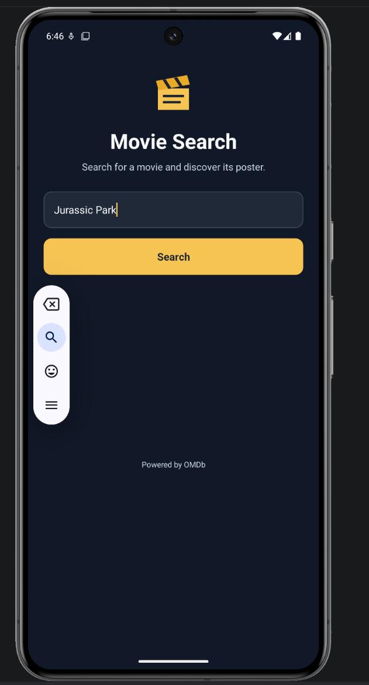
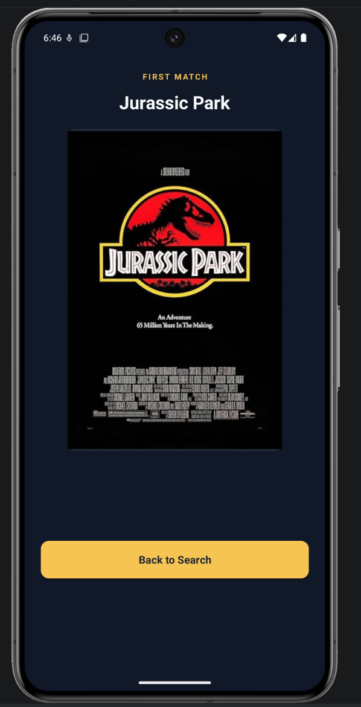
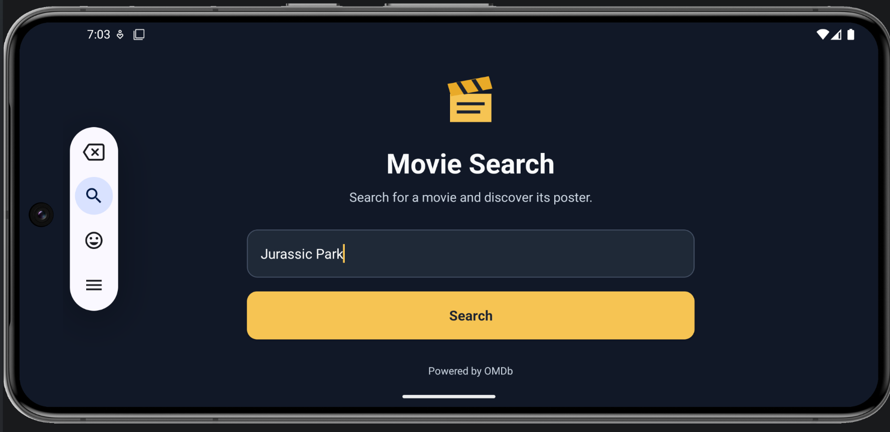
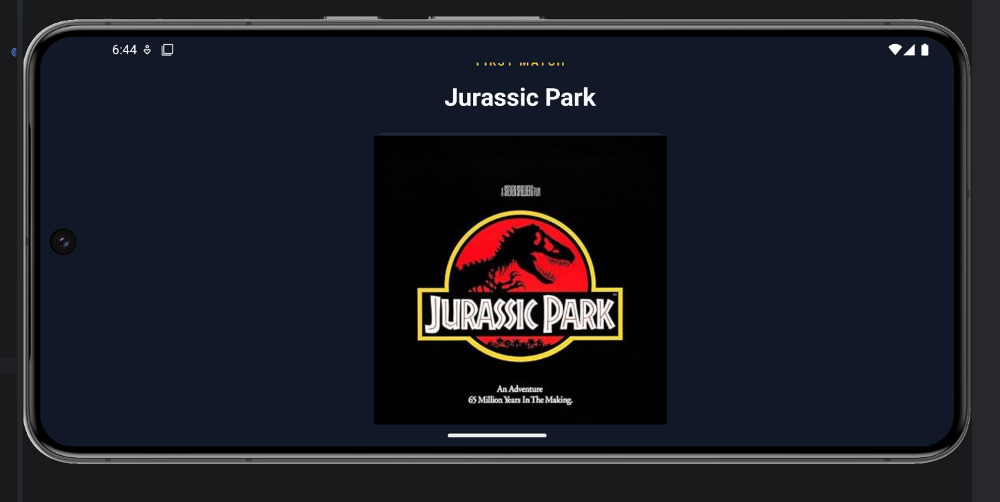
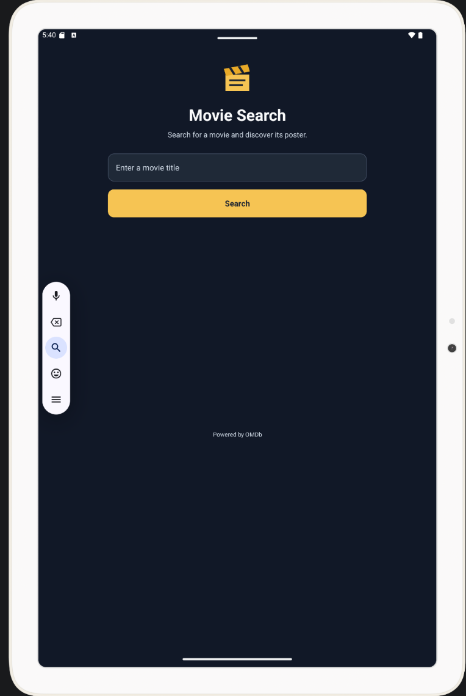
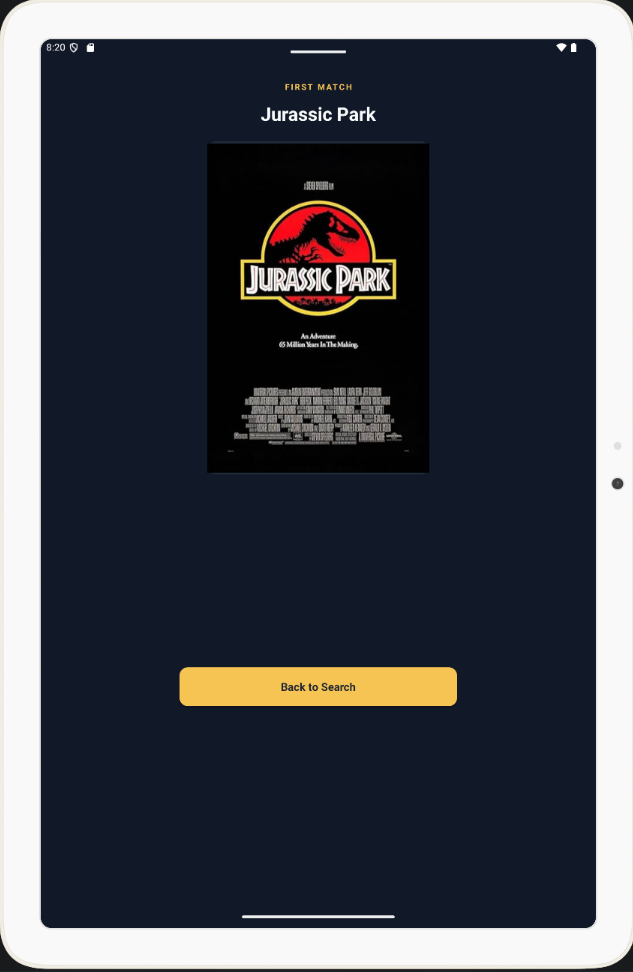

# Terrible Movie Search

Terrible Movie Search is a Kotlin Android application developed for the **Survey of Programming Languages** course. It searches the [Open Movie Database (OMDb)](https://www.omdbapi.com/) by title and displays the **first matching movie**, including its title and poster.

## Features

- Launch screen with an application name and clapperboard logo.
- Movie-title searches using **Volley** and the OMDb JSON API.
- Navigation between the search and result Activities using **Intent extras**.
- Poster loading with **Picasso**, including loading and unavailable-poster placeholders.
- Toast messages for empty searches, missing results, missing API keys, and network errors.
- Search-text preservation when the device rotates.
- Scrollable, responsive layouts for phone and tablet screens in portrait and landscape.

## Technologies

| Component | Technology |
| --- | --- |
| Language | Kotlin |
| Interface | Android Views, XML and ConstraintLayout |
| Networking | Volley 1.2.1 |
| Image loading | Picasso 2.8 |
| Movie data | OMDb API |
| Build | Gradle 8.10.2 / Android Gradle Plugin 8.8.2 |
| Android SDK | Compile/target API 35; minimum API 26 |

## Setup and build

1. Clone the repository and open the **TerribleMovieSearch** project folder in Android Studio.
2. Install Android SDK Platform 35 if Android Studio prompts you to do so, and select **JDK 17** as the Gradle JDK.
3. Request and activate a free OMDb API key from [OMDb's API-key page](https://www.omdbapi.com/apikey.aspx).
4. In the project root, create `local.properties` (or copy `local.properties.example`) and enter:

   ```properties
   OMDB_API_KEY=YOUR_OMDB_API_KEY
   ```

   Android Studio may also add a local `sdk.dir` entry pointing to your installed Android SDK. Keep that entry if present.

5. Synchronize Gradle and choose an Android emulator or connected device. Press **Run** in Android Studio, or build a debug APK using:

   ```bash
   ./gradlew assembleDebug
   ```

`local.properties` is excluded from Git because it contains local configuration and the API key. Do not add a real API key to tracked source files. Note that a key compiled into a client-side APK is not secret against someone inspecting that APK.

## Using the application

Enter a movie title and press **Search** (or use the keyboard's Search action). If OMDb finds a result, the app opens a second screen showing the first match's title and poster. Select **Back to Search** to return to the existing search screen.

## Screenshots

The images below were captured from Android emulators running the application.

| Device | Search screen | Result screen |
| --- | --- | --- |
| Phone — portrait |  |  |
| Phone — landscape |  |  |
| Tablet — portrait |  |  |

Phone and tablet landscape operation were also tested during development.

## Project structure

- `SplashActivity.kt` — Brief launch screen.
- `MainActivity.kt` — Search input, Volley request, result parsing, and state preservation.
- `ResultActivity.kt` — Intent-extra handling, poster display, and Back navigation.
- `app/src/main/res/layout/` — XML layouts for the three Activities.
- `app/src/main/res/drawable/` — Logo, background shapes, and poster placeholders.
- `screenshots/` — Device screenshots used for this assignment.

## AI assistance and assets

AI assistance was used to create the initial Android project, including Kotlin/XML implementation and original vector-drawable artwork (the clapperboard logo and poster placeholders), and during debugging and documentation. These vector assets were created for this project; the movie posters shown in search results are supplied by external image URLs returned by OMDb, **not** generated by AI.

## Testing and limitations

The app has been built successfully and exercised on a Pixel 8 Pro emulator and a tablet emulator, including portrait and landscape layouts. Successful searches, poster display, Back navigation, and search-text retention across rotation were observed. Error placeholders and Toast-based failure handling are implemented; not all possible network failures and device sizes have been exhaustively tested.

Movie information and poster images require working external services and an internet connection. If a poster URL is unavailable or an image download fails, the app shows a placeholder instead of a blank image. No other reproducible functional defect is currently known.

## References

- [OMDb API](https://www.omdbapi.com/)
- [Android Developers](https://developer.android.com/)
- [Volley](https://google.github.io/volley/)
- [Picasso](https://square.github.io/picasso/)
